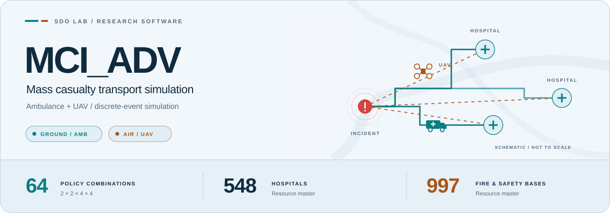
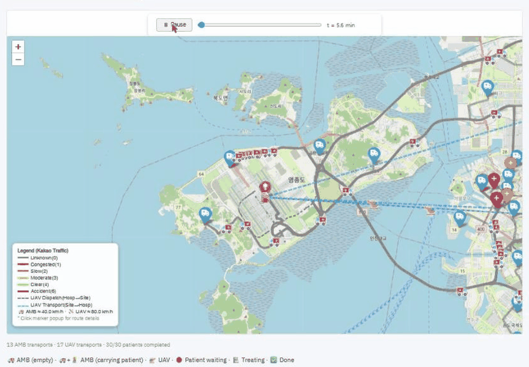
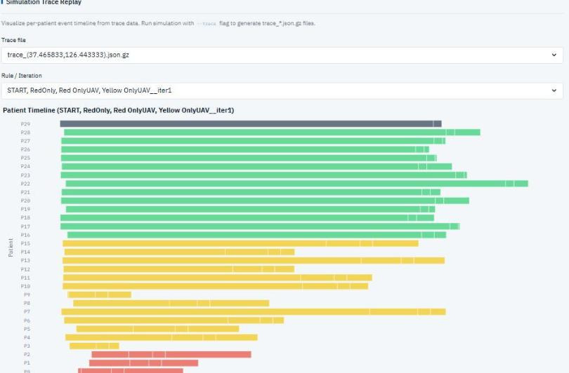
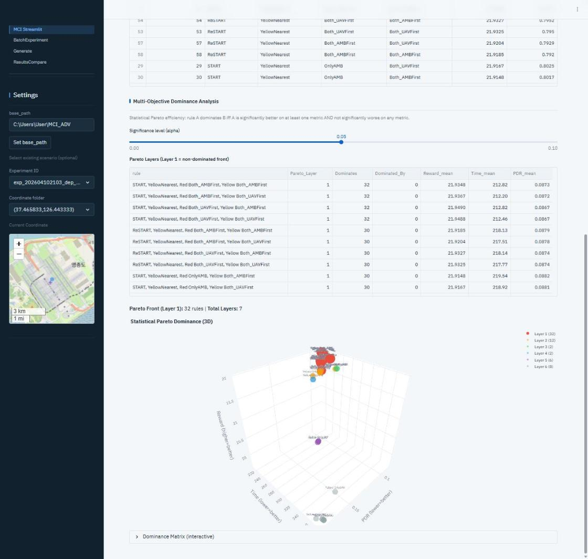
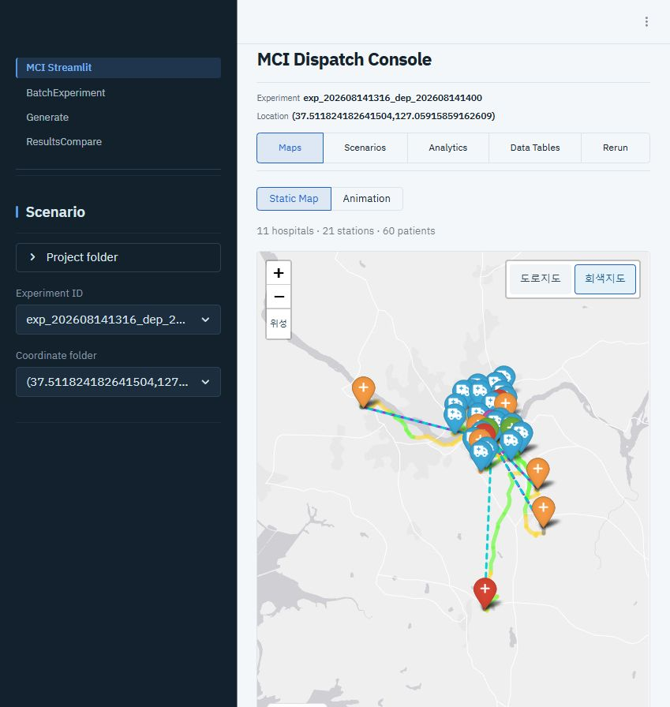
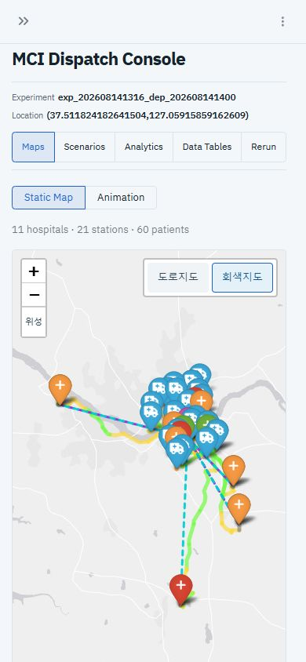
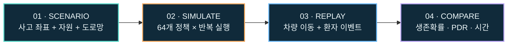

<div align="center">

<picture>
  <source media="(prefers-color-scheme: dark)" srcset="docs/readme/hero-dark.svg">
  <source media="(prefers-color-scheme: light)" srcset="docs/readme/hero-light.svg">
  
</picture>

# MCI_ADV

**재난 현장의 환자를 어느 병원에, 어떤 수단으로 보낼 것인가.**

사고 좌표에서 시나리오를 만들고, 구급차·UAV 이송 정책 64개를 같은 조건에서 실행합니다. 차량 이동과 환자별 경과를 재생하고 생존확률·예방가능사망률(PDR)·소요시간으로 정책을 비교합니다.

<p>
  <a href="requirements.txt"></a>
  <a href="requirements.txt"></a>
  <a href="requirements.txt"></a>
  <a href="#라우팅-백엔드"></a>
</p>
<p>
  <a href="https://github.com/SDOlab/MCI_ADV/commit/72b162a"></a>
  <a href="docs/data_sync_20261019/manifest.json"></a>
  <a href="USER_MANUAL_KO.md"></a>
  <a href="USER_MANUAL_EN.md"></a>
</p>

[대시보드](#대시보드) &nbsp; / &nbsp; [시작하기](#시작하기) &nbsp; / &nbsp; [정책 구성](#정책-구성) &nbsp; / &nbsp; [파이프라인](#파이프라인) &nbsp; / &nbsp; [설정·출력](#설정과-출력) &nbsp; / &nbsp; [문서](#문서)

</div>

> [!NOTE]
> 2026-10-19 반영: 지도 안 도로·회색·위성 전환, OSRM table 일괄 조회, 자원 데이터 동기화.
> 커버의 자원 수는 [동기화 명세](docs/data_sync_20261019/manifest.json) 기준이며, 이송망 그림은 개념도입니다. [변경·검증 기록 보기](docs/dashboard_upgrade_20261019.md)

## 대시보드

<p align="center">
  
  <br>
  <sub>Maps / Animation · 저장된 경로와 이벤트 trace로 차량 이동을 재생합니다.</sub>
</p>

<table>
  <tr>
    <td width="50%" valign="top">
      
      <br><b>환자 한 명의 경과까지</b><br>
      <sub>구조부터 이송·병원 도착·치료 완료까지, 이벤트를 시간순으로 확인합니다.</sub>
    </td>
    <td width="50%" valign="top">
      
      <br><b>정책 사이의 차이</b><br>
      <sub>생존확률·PDR·시간을 함께 놓고 Pareto 지배와 통계 검정으로 비교합니다.</sub>
    </td>
  </tr>
</table>

<details>
<summary>최근 지도 화면과 모바일 화면</summary>

<table>
  <tr>
    <td width="68%" valign="top"></td>
    <td width="32%" valign="top"></td>
  </tr>
</table>

지도 타일은 페이지 재실행 없이 전환됩니다. 선택한 경로에 화면 범위를 맞추고, 범례는 접어서 볼 수 있습니다.

</details>

| 하고 싶은 일 | 화면 |
|---|---|
| 사고 좌표와 자원 수를 정해 새 실험 만들기 | Generate |
| 도로 경로·차량 이동 보기 | Maps |
| 환자별 상태·대기·치료 경과 따라가기 | Scenarios / Trace Replay |
| ANOVA·사후검정·Pareto·부트스트랩 분석 | Analytics |
| 시나리오 표 수정, 기존 조건으로 재실행 | Data Tables / Rerun |
| 여러 좌표의 정책 순위·효과 비교 | ResultsCompare |
| 배치 실험 진행률·결과·보고서 확인 | BatchExperiment |

## 시작하기

Python 3.12와 [requirements.txt](requirements.txt)의 패키지를 사용합니다. 명령은 저장소 루트에서 실행합니다.

```bash
git clone https://github.com/SDOlab/MCI_ADV.git
cd MCI_ADV
conda create -n MCI python=3.12 -y
conda activate MCI
python -m pip install -r requirements.txt
python -m streamlit run src/vis_src/MCI_Streamlit.py
```

브라우저에서 **Generate**를 열고 사고 좌표·환자 수·차량 수를 입력합니다. 기본 라우팅은 Kakao이며 API 키가 필요합니다. 키 없이 시작하려면 **Use Kakao Mobility API duration (real-time traffic)** 체크를 해제해 OSRM을 선택합니다.

<details>
<summary>CLI로 시나리오 생성·시뮬레이션 실행</summary>

다음 예시는 서울시청 좌표, 환자 30명, 구급차 30대, UAV 3대, OSRM 라우팅을 사용합니다. 각 명령은 한 줄이며 PowerShell과 Bash에서 같습니다.

```bash
python src/sce_src/make_csv_yaml_dynamic.py --base_path . --latitude 37.5665 --longitude 126.9780 --incident_size 30 --amb_count 30 --uav_count 3 --total_samples 30 --random_seed 0 --experiment_id readme_demo --is_use_time false
python src/sim_src_upgrade/drivers/run_sim_fast.py -- --config_path "scenarios/exp_readme_demo_osrm/(37.5665,126.978)/config_(37.5665,126.978).yaml" --trace
```

첫 명령은 도로 데이터를 조회해 시나리오를 저장하고, 두 번째 명령은 기본 정책 64개를 30회씩 실행합니다. 원본 코어로 직접 실행할 때는 같은 인수를 `src/sim_src/main.py`에 전달합니다.

Kakao는 `--is_use_time true`를 사용합니다. CLI 키는 `KAKAO_API_KEY` 환경 변수 또는 `--kakao_api_key`로 지정합니다. 조회 시각은 `--departure_time YYYYMMDDHHMM`으로 정합니다.

시나리오 폴더명은 OSRM에서 `exp_<id>_osrm`, Kakao에서 `exp_<id>`이며 출발 시각을 지정하면 `_dep_<YYYYMMDDHHMM>`이 붙습니다.

</details>

## 정책 구성

기본 비교군은 **2 × 2 × 4 × 4 = 64개**입니다. [RuleManager](src/sim_src/RuleManager.py)가 네 요소의 조합을 만듭니다.

| 결정 요소 | 선택지 | 수 |
|---|---|---:|
| 환자 우선순위 | `START`, `ReSTART` | 2 |
| 병원 선택 규칙 | `RedOnly`, `YellowNearest` | 2 |
| Red 환자 이송수단 | `OnlyUAV`, `Both_UAVFirst`, `Both_AMBFirst`, `OnlyAMB` | 4 |
| Yellow 환자 이송수단 | Red와 같은 네 방식 | 4 |

정책들은 같은 난수 시드로 반복 실행합니다(CRN). 같은 사고 조건에서 정책별 결과를 짝지어 비교합니다.

<details>
<summary>시뮬레이션 모델과 분석 범위</summary>

`heapq` 이벤트 큐가 구조, 배차, 이송, 병원 도착과 치료를 분 단위로 처리합니다. UAV는 헬기장 보유 병원에 착륙하며, 병원 수용량이 차면 다른 병원으로 전원합니다. Green·Black 환자의 일괄 이송은 Red·Yellow 이송 후 처리합니다.

병원 후보는 사고 지점에서 가까운 순으로 선정합니다. 기본 용량 버퍼는 환자 수의 1.5배이며, 병원 종별·헬기장 확보 규칙이 함께 적용됩니다. 실제 선택 조건은 [시나리오 생성기](src/sce_src/make_csv_yaml_dynamic.py)에 있습니다.

Analytics에는 RCBD / Reduced-Factorial ANOVA, EMM 사후검정과 Holm 보정, CLD, 효과크기(η²·ω²), 잔차 진단, Pareto 지배 분석이 있습니다. BCa 부트스트랩·비모수 검정·검정력 분석과 LaTeX 내보내기도 지원합니다.

</details>

## 파이프라인



| 단계 | 코드 | 저장 위치 |
|---|---|---|
| 시나리오 생성·실행 관리 | [sce_src](src/sce_src/) | `scenarios/<exp>/(lat,lon)/` |
| 시뮬레이션 | [sim_src](src/sim_src/) · [고속 경로](src/sim_src_upgrade/) | `results/<exp>/(lat,lon)/` |
| 지도·이벤트 재생·통계 | [vis_src](src/vis_src/) | Streamlit 대시보드, 분석 내보내기 |
| 여러 좌표 배치 실행 | [experiment_1](experiment_1/) | 진행 상태, 좌표별 결과, 보고서 |

<details>
<summary>저장소 구조와 고속 실행 경로</summary>

```text
MCI_ADV/
├── src/
│   ├── sce_src/            시나리오 생성·오케스트레이션
│   ├── sim_src/            기준 시뮬레이션 코어
│   ├── sim_src_upgrade/    고속 코어·드리프트 검사·동치검증
│   └── vis_src/            Streamlit 앱·개별 페이지
├── scenarios/             자원 마스터·생성 시나리오
├── results/               실행 결과 (Git 제외)
├── experiment_logs/       실행 로그 (Git 제외)
├── experiment_1/          다좌표 배치 실험·보고서
├── docs/                  화면 이미지·변경 및 검증 기록
├── USER_MANUAL_KO.md
├── USER_MANUAL_EN.md
└── requirements.txt
```

대시보드와 배치 실행은 기본적으로 고속 코어를 사용합니다. 실행 전에 기준 코어의 해시를 검사하고, 드리프트가 있으면 원본 코어로 돌아갑니다. `MCI_FAST_CORE=0`으로 비활성화합니다.

동치검증 방법과 기존 측정 조건은 [고속 코어 문서](src/sim_src_upgrade/README.md)에 있습니다. 코어를 수정했다면 다음 명령으로 기준 파일 해시를 먼저 확인합니다.

```bash
python src/sim_src_upgrade/origin_sync.py --check
```

</details>

## 라우팅 백엔드

| | Kakao Mobility | OSRM |
|---|---|---|
| 선택 | `--is_use_time true` (기본) | `--is_use_time false` |
| 도로 정보 | 실시간 또는 지정 시각의 예측 소요시간 | 정적 도로망 |
| 키·서버 | `KAKAO_API_KEY` | 키 불필요, `MCI_OSRM_URL`로 서버 지정 |
| 시뮬레이션 이동시간 | 저장된 API duration 사용 | 기본은 거리 ÷ 속도 |
| 조회 결과 | `routes/`에 원본 응답 보관 | table 원본과 구간별 참조 보관, 지도 경로선은 필요할 때 조회 |

OSRM은 거리·시간을 최대 40구간씩 묶어 조회합니다. table을 지원하지 않거나 값이 누락된 구간은 route로 재시도합니다. 지도 경로선은 필요한 구간만 불러와 1시간 캐시합니다.

<details>
<summary>Kakao 키 설정</summary>

대시보드는 환경 변수 `KAKAO_API_KEY` / `KAKAO_REST_API_KEY`, Generate 화면 입력 또는 다음 Streamlit secrets를 읽습니다.

```toml
# .streamlit/secrets.toml
[kakao]
rest_api_key = "YOUR_KAKAO_REST_API_KEY"
```

CLI 생성기의 키 입력은 `KAKAO_API_KEY` 또는 `--kakao_api_key`를 사용합니다. 키를 저장소에 커밋하지 않습니다.

</details>

<details>
<summary>OSRM 서버 직접 실행</summary>

### OSRM 백엔드

공개 데모 서버는 소규모 확인에 사용하고, 대량 생성은 자체 서버에서 실행합니다. 다음은 Docker와 Bash 기준입니다.

```bash
wget https://download.geofabrik.de/asia/south-korea-latest.osm.pbf
docker run -t -v "$(pwd):/data" osrm/osrm-backend osrm-extract -p /opt/car.lua /data/south-korea-latest.osm.pbf
docker run -t -v "$(pwd):/data" osrm/osrm-backend osrm-partition /data/south-korea-latest.osrm
docker run -t -v "$(pwd):/data" osrm/osrm-backend osrm-customize /data/south-korea-latest.osrm
docker run -d -p 5000:5000 -v "$(pwd):/data" osrm/osrm-backend osrm-routed --algorithm mld /data/south-korea-latest.osrm
```

PowerShell에서 서버 주소를 지정하는 예:

```powershell
$env:MCI_OSRM_URL = "http://localhost:5000"
```

Bash에서는 `export MCI_OSRM_URL=http://localhost:5000`을 사용합니다.

OSRM으로 생성한 CSV에도 duration이 저장됩니다. 기존 시나리오 YAML의 `is_use_time`을 `True`로 바꾸면 저장된 OSRM duration으로 재실행합니다. 이 값에는 실시간 혼잡도가 포함되지 않습니다.

</details>

## 설정과 출력

<details>
<summary>환경 변수</summary>

| 변수 | 기본값 | 용도 |
|---|---|---|
| `KAKAO_API_KEY` | 없음 | Kakao 라우팅 인증 |
| `MCI_OSRM_URL` | 공식 공개 데모 서버 | OSRM 서버 주소 |
| `MCI_FAST_CORE` | `1` | `0`이면 원본 코어 사용 |
| `MCI_WRITE_RUN_LOG` | `1` | 대시보드가 trace를 찾는 실행 로그 저장. 기본값 유지 권장 |
| `MCI_TRACE_PRINT` | `1` | `0`이면 고속 코어의 trace 없는 실행에서 이벤트 콘솔 출력 생략 |
| `MCI_CAP_GATE` | `occ` | `psent`는 현장 발송 수로 용량 게이트 계산 |
| `MCI_MAX_SEND_COEFF` | `1,1` | 발송 상한 = a × 수술실수 + b × 병상수 |
| `MCI_BUFFER_RATIO` | `1.5` | 병원 후보 풀의 용량 버퍼 |
| `MCI_CAPA_SCALE` | `1` | 병원 용량 배율 |
| `MCI_INCIDENT_SIZE` / `MCI_AMB_NUM` / `MCI_UAV_NUM` | 시나리오 설정 | 실행 시 환자·구급차·UAV 수 재정의 |

시뮬레이션 자체 로그(`sim_*.log`)는 `main.py --log`로 켭니다. trace를 저장하는 `--trace`와 별도 옵션입니다.

</details>

<details>
<summary>결과 파일과 trace</summary>

| 파일 | 내용 |
|---|---|
| `results/<exp>/(lat,lon)/results_(lat,lon).txt` | 정책별 반복 원자료. 기본 320행 = 64정책 × 5지표 |
| `results_(lat,lon)_stat.txt` | 정책별 평균·표준편차·95% 신뢰구간 반폭 |
| `trace_(lat,lon).json.gz` | gzip JSON Lines 형식의 정책·반복별 이벤트 |
| `experiment_logs/(lat,lon)_<ts>.txt` | 실행 로그와 trace 경로 |
| `scenarios/<exp>/<exp>_summary.csv` | 좌표별 생성·실행 요약 |

원자료의 다섯 지표는 Reward, Time, PDR, Reward w.o.G, PDR w.o.G입니다. 열은 반복 시행에 대응합니다.

trace에는 `onset`, `rescue`, `vehicle_arrival_site`, `transport_start`, `hospital_arrival`, `diversion`, `care_ready`, `care_start`, `care_complete` 이벤트가 기록됩니다. 대시보드의 애니메이션과 환자별 Trace Replay가 이 파일을 읽습니다.

이전 stdout 이벤트 로그도 읽습니다. 반복 101회 이상에서는 로그 뷰어를 끄지만 Trace Replay로 trace를 계속 조회합니다.

</details>

<details>
<summary>데이터와 재현 조건</summary>

자원 마스터는 병원 548곳, 안전센터·소방서 997곳입니다([2026-10-19 명세](docs/data_sync_20261019/manifest.json)). 병원 대장과 거리행렬의 기관명·좌표 일치 여부는 [자료 일치 기록](docs/data_sync_20261019/source_consistency.json)에 있습니다. 기존에 생성한 시나리오는 생성 당시 자원과 경로를 사용합니다.

시나리오, 난수 시드와 실행 설정을 함께 보관합니다. Kakao 교통 정보는 조회 시각에 따라 달라지므로 경로 원본 응답도 `routes/`에 저장합니다.

2026-08-13 시뮬레이션 정합성 동기화 전후 결과는 구분해 비교합니다. 변경 범위는 [MCI_UAV 동기화 기록](SYNC_MCI_UAV.md)에 있습니다. 한글 마스터 CSV는 CP949이며 읽을 때 UTF-8-sig, CP949 순으로 시도합니다.

</details>

## 문서

| 문서 | 찾을 내용 |
|---|---|
| [한국어 매뉴얼](USER_MANUAL_KO.md) · [English manual](USER_MANUAL_EN.md) | 화면별 사용법·설정·오류 대응 |
| [최근 지도·라우팅 변경](docs/dashboard_upgrade_20261019.md) | 2026-10-19 반영 범위와 검증 조건 |
| [배치 실험](experiment_1/README.md) · [실험 보고서](experiment_1/EXPERIMENT_REPORT.md) | 다좌표 생성·재개·분석 |
| [고속 코어](src/sim_src_upgrade/README.md) | 실행 경로·드리프트 게이트·동치검증 |
| [MCI_UAV 동기화](SYNC_MCI_UAV.md) | 연구 저장소와의 로직·자료 정합성 |
| [코드 리뷰](CODE_REVIEW_REPORT.md) | 모듈 구조와 검토 기록 |

<p align="center">
  <a href="https://github.com/SDOlab/MCI_ADV/issues">문제 보고·제안</a> &nbsp; · &nbsp;
  <a href="https://github.com/SDOlab">SDO Lab</a> &nbsp; · &nbsp;
  <a href="#mci_adv">맨 위로</a>
</p>
